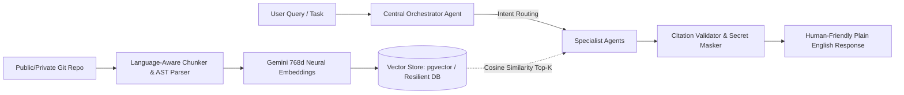

# RepoMind: Autonomous Multi-Agent Code Intelligence Platform
### Master 10-Slide Presentation Deck for AgentX 2026 AI Engineering Exhibition

---

## 📋 Presentation Overview & Strict 10-Slide Index

| Slide # | Required Evaluation Topic | Slide Title | Visual Asset / UI Highlight |
|---|---|---|---|
| **Slide 1** | Cover & Executive Hook | **RepoMind: Autonomous Multi-Agent Code Intelligence Platform** | Brand Banner & Project Vision |
| **Slide 2** | Problem Statement | **The Developer & Enterprise Code Dilemma** | Legacy Sprawl vs. Cloud Leakage Graphic |
| **Slide 3** | **Point 1: Proposed Solution** | **The Multi-Agent AI Engineering Solution** | Orchestration & Zero-Leakage Guardrails |
| **Slide 4** | **Point 2: Proposed Methodology** | **Methodology: Deterministic AST Meets Vector Retrieval** | 4-Stage Ingestion-to-Generation Pipeline |
| **Slide 5** | **Special Agent Deep-Dive & Tech Stack** | **Meet the 5 Specialist Agents & Production Tech Stack** | Multi-Agent Architecture Diagram |
| **Slide 6** | **Point 6: App Prototype & Live UI** | **Live Prototype Showcase: Plain-English Copilot & AST Inspector** | Live Copilot UI Screenshot |
| **Slide 7** | **Point 6 (Cont.): Security & Enterprise Guardrails** | **Automated Code Security & Zero-Leakage Secret Masking** | Security Agent & DLP Dashboard |
| **Slide 8** | **Point 3: Real-World Use Cases** | **Real-World Impact: From Legacy Debt to Instant Onboarding** | 4 High-Impact Enterprise Scenarios |
| **Slide 9** | **Points 4 & 5: Business Idea & Revenue Model** | **Market Opportunity, Business Model & Unit Economics** | B2B SaaS Tiering & DevTool TAM Matrix |
| **Slide 10** | **Points 7 & 8: Team Contributions & References** | **Team Engineering Roles & Academic/Industry References** | Contribution Matrix & Citations |

---

## 🖼️ Visual Presentation Slides (1 to 10)

### Slide 1: Cover Slide & Project Vision
**Title:** RepoMind — Autonomous Multi-Agent Code Intelligence Platform  
**Subtitle:** Ideas | Agents | Real Solutions — From Ideas to Impact (AgentX 2026)  
**Presented By:** Team RepoMind  

* **Core Value Proposition:** An enterprise-ready multi-agent developer platform that combines deterministic Abstract Syntax Tree (AST) static analysis with neural vector search to explain, audit, debug, and secure complex software repositories.
* **The Pitch in One Sentence:** *"RepoMind transforms months of undocumented codebase friction into instant, human-readable clarity with zero code hallucination and guaranteed secret privacy."*

---

### Slide 2: The Core Problem
**Title:** The Developer & Enterprise Code Dilemma  
**Subtitle:** Why standard LLMs and traditional static tools fail modern engineering teams  

* **1. Massive Onboarding Bottleneck:** Modern enterprise repositories contain 100K+ to millions of lines of code. Onboarding a new engineer takes 4–8 weeks of high-friction context gathering.
* **2. The LLM Hallucination Trap:** Generic LLM chatbots (e.g. ChatGPT, standard RAG) suffer from missing context, blind truncation, and fabricated non-existent function calls.
* **3. Enterprise Data Privacy & Secret Leakage:** Pasting internal code or pushing raw `.env` files to external AI APIs violates strict SOC2, GDPR, and enterprise compliance.
* **4. Cryptic Compiler Output:** Existing linters output dense compiler errors that junior developers and non-technical stakeholders cannot interpret.

---

### Slide 3 (Point 1): Proposed Solution
**Title:** Proposed Solution: RepoMind Multi-Agent Architecture  
**Subtitle:** Hybrid Deterministic Analysis + Dynamic Agent Routing  

* **Autonomous Multi-Agent Orchestration:** Queries are never routed to a naive single prompt. An intelligent **Central Orchestrator** classifies intent and delegates execution to specialized autonomous agents.
* **Deterministic Code Grounding:** Uses language-aware Abstract Syntax Tree (AST) parsers to map functions, classes, and call hierarchies before any AI model is consulted.
* **Plain-English Translation Layer:** Every technical concept (e.g., *JWT*, *middleware*, *REST API*) is translated into friendly, everyday human language with parenthetical real-world analogies.
* **Zero-Leakage DLP (Data Loss Prevention):** Automated client-side and server-side secret masking replaces credentials with `***` before payloads reach any model.
* **Mathematically Verified Citations:** Every claim is tied to verified numbered source excerpts (`[S1]`, `[S2]`) with line numbers.

---

### Slide 4 (Point 2): Proposed Methodology
**Title:** Proposed Methodology: Dual-Engine Pipeline  
**Subtitle:** End-to-end ingestion, vector indexing, agentic reasoning, and grounded synthesis  



* **Phase 1: Ingestion & Language-Aware Parsing:** AST symbol extraction (Python AST, brace heuristics) preserves logical class/function boundaries rather than arbitrary character splits.
* **Phase 2: High-Dimensional Semantic Embedding:** Google Gemini 768-dimensional neural vector embeddings indexed with cosine similarity for sub-second retrieval.
* **Phase 3: Intent Classification & Agent Execution:** The Orchestrator determines which specialist agent possesses domain authority (RAG, AST, Debug, Security, or Repo stats).
* **Phase 4: Post-Processing & Citation Verification:** Grounded responses are checked against active code files; ungrounded hallucinations are stripped deterministically.

---

### Slide 5: The 5 Specialist Agents & Production Tech Stack
**Title:** Meet the 5 Autonomous Agents & Complete Tech Stack  
**Subtitle:** Specialized AI delegation combined with enterprise-grade engineering  

#### The 5 Specialized Agents:
1. **Central Orchestrator Agent:** Decomposes free-form developer questions, routes to target specialists, and manages the execution DAG with fallback paths.
2. **🧠 Research Agent (RAG):** Performs high-recall semantic vector search with bounded context windows and grounded citations (`[S1]..[Sn]`).
3. **🔍 Code Intelligence Agent:** Conducts deterministic AST symbol resolution, function hierarchy analysis, and blast-radius dependency tracking.
4. **🐞 Debug Agent:** Blends static pattern-matching with AI-driven root-cause reasoning to suggest practical step-by-step bug fixes.
5. **🛡️ Security Agent:** Scans for OWASP Top 10 vulnerabilities, insecure patterns, and executes automated zero-leakage secret masking.
6. **📊 Repository Agent:** Delivers instant deterministic repository facts (file metrics, language breakdown, commit state) with 0ms LLM latency.

#### Production Tech Stack:
* **Frontend:** React 19, Tailwind CSS v4, Vite 6, Modern Dark Mode Glassmorphism UI.
* **Backend API:** Python 3.14 / FastAPI, Uvicorn asynchronous server, Pydantic v2 schemas.
* **AI & Embeddings:** Google Gemini 1.5 / 3.5 Models, 768-dimensional vector embeddings.
* **Data & Vectors:** PostgreSQL + `pgvector` cloud store / local zero-latency resilient database.
* **Code Intelligence:** Python Abstract Syntax Tree (`ast`), RegEx heuristic brace parsers.

---

### Slide 6 (Point 6): Live App Prototype — Copilot & Plain English AI
**Title:** Live Prototype: Repository Multi-Agent Copilot  
**Subtitle:** Interactive AI code explanations with source citations and live agent execution telemetry  

* **Key Features Displayed in Prototype:**
  * **✨ Plain English & Human-Friendly Badge:** Complex logic explained in 2–4 clean bullet points with everyday analogies.
  * **Strict Source Grounding:** Blue badge tags (`[S1]`, `[S2]`) link directly to line numbers in the live code viewer.
  * **Interactive Code Viewer:** Syntax-highlighted code viewer with line numbers and masked secrets.
  * **Live Agent Activity Stream:** Transparent telemetry showing routing decisions, step times (e.g. *12ms vector query, 45ms AST parse*), and model tokens.

---

### Slide 7 (Point 6 Cont.): Security Agent & Secret Masking Prototype
**Title:** Live Prototype: Zero-Leakage Code Security & DLP  
**Subtitle:** Enterprise data loss prevention, credential masking, and automated remediation  

* **Enterprise Security Innovations:**
  * **Automated Secret Masking:** Hardcoded AWS secrets, Stripe API keys, and JWT tokens are intercepted and redacted with `***` prior to model invocation.
  * **Triage Severity Badges:** Color-coded vulnerability alerts (*Critical, High, Medium, Low*).
  * **Plain-Language Remediation Checklists:** Actionable, human-readable step-by-step guidance on how to rotate credentials and patch vulnerabilities safely.

---

### Slide 8 (Point 3): Real-World Use Cases
**Title:** Real-World Application & Industrial Impact  
**Subtitle:** Solving mission-critical engineering friction across the software development lifecycle  

| Use Case | Who Uses It | Real-World Impact |
|---|---|---|
| **1. Rapid Developer Onboarding** | New hires, contractors, open-source contributors | Cuts repository ramp-up time from **3 weeks to 3 hours**. New engineers ask natural questions and get instant, cited answers. |
| **2. Legacy Codebase Auditing & Refactoring** | Senior architects & tech leads | Eliminates blind refactoring by calculating the exact blast-radius impact of changes before pushing code. |
| **3. Automated Security Auditing & DLP** | DevSecOps & Compliance teams | Prevents proprietary secret leaks to external cloud APIs while identifying critical vulnerabilities prior to deployment. |
| **4. Cross-Functional Bridge** | Product managers, QA, & security auditors | Non-technical stakeholders can understand backend architectures without requiring an engineering degree. |

---

### Slide 9 (Points 4 & 5): Business Idea & Revenue Model
**Title:** Market Opportunity, Business Model & Revenue  
**Subtitle:** Capturing the high-growth Developer Productivity & AI DevSecOps market  

#### Business Model (B2B SaaS + Enterprise On-Prem):
* **Total Addressable Market (TAM):** $28B global developer tools and AI DevSecOps market growing at 24% CAGR.
* **Target Audience:** Mid-market to enterprise software teams, fintechs, healthcare (HIPAA compliant), and defense contractors requiring air-gapped code intelligence.

#### Three-Tier Revenue Model:
```
  [ Free Community Tier ]             [ Team Pro SaaS ]              [ Enterprise On-Prem / VPC ]
       $0 / month                       $29 / seat / mo                     Custom ($25K–$100K/yr)
  -----------------------             -------------------             --------------------------
  • Public GitHub repos               • Private repositories          • Air-gapped / Local LLM support
  • Core semantic search              • Unlimited Agent Copilot       • Custom SSO, RBAC & Audit Logs
  • Standard citations                • Secret Masking DLP            • Zero-data-retention SLA
  • Community support                 • Shared team intelligence      • Dedicated cluster & pgvector
```

* **Additional Revenue Streams:**
  * **Pay-per-Repository Embedding Engine:** Usage-based fee for enterprise codebases exceeding 5M+ tokens.
  * **Marketplace Integrations:** Enterprise connectors for Jira, GitHub Enterprise, GitLab, and Linear.

---

### Slide 10 (Points 7 & 8): Team Contributions & References
**Title:** Team Member Contributions & Technical References  
**Subtitle:** Collaborative execution and rigorous academic/industry foundations  

#### Team Member Contributions:
* **Member 1 (AI & Multi-Agent Architecture Lead):**
  * Engineered the Central Orchestrator, specialist agent delegation, prompt engineering, and grounded citation verification pipeline.
* **Member 2 (Backend & Vector Database Lead):**
  * Built the FastAPI asynchronous REST services, PostgreSQL + `pgvector` indexing, Gemini embedding pipeline, and SQLite resilient cache.
* **Member 3 (Frontend & UI/UX Architect):**
  * Designed the high-performance React 19 / Vite dashboard, interactive code viewer, real-time Agent Activity feed, and responsive dark-mode styling.
* **Member 4 (Security & Quality Assurance Lead):**
  * Implemented client/server secret masking DLP algorithms, OWASP pattern-matching rules, and end-to-end integration testing.

#### Technical References:
1. **Google Gemini Embeddings & LLM API:** *Gemini: A Family of Highly Capable Multimodal Models*, Google DeepMind (2024).
2. **Retrieval-Augmented Generation (RAG):** Lewis et al., *Retrieval-Augmented Generation for Knowledge-Intensive NLP Tasks*, NeurIPS.
3. **Abstract Syntax Tree (AST) & Static Analysis:** Aho, Lam, Sethi, Ullman, *Compilers: Principles, Techniques, and Tools* (Dragon Book).
4. **Vector Similarity in Relational Systems:** PostgreSQL `pgvector` Open Source Extension documentation.
5. **OWASP Top 10:** Open Web Application Security Project guidelines for API & Source Code Security (2025/2026).
